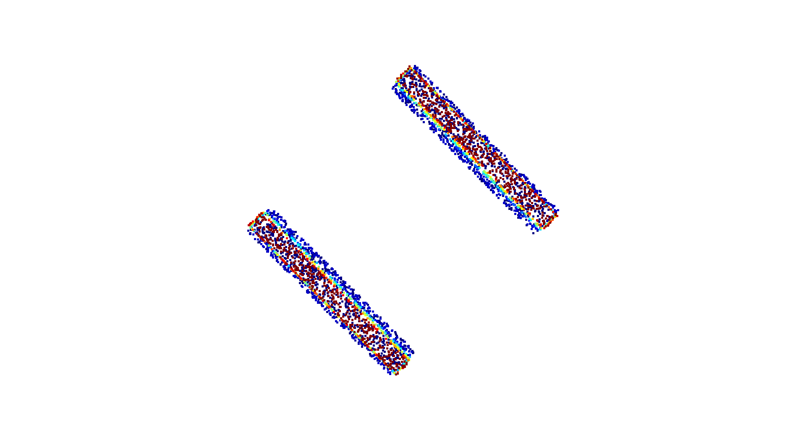

# BIM-to-CIM Infrastructure Demo

**An end-to-end pipeline: IFC parsing → labeled point cloud generation → 3D deep learning classification → GeoJSON export**

---

## About This Project
This repository demonstrates a minimum viable workflow to connect **engineering-level BIM (Industry Foundation Classes)** and **city-level CIM (City Information Modeling)**. It verifies the technical feasibility of converting infrastructure BIM models into geospatial data formats and applying 3D deep learning for automatic component recognition.

This work is prepared as a technical demonstration for research orientation in **GeoAI and infrastructure digital twins**.

---

## Pipeline Overview
1. **IFC Parsing**  
   Parse the IFC model and extract civil elements with full geometric and attribute information via IfcOpenShell.

2. **Labeled Point Cloud Generation**  
   Generate uniformly sampled point clouds from element meshes, with per-element category labels for deep learning.

3. **3D Component Classification**  
   Train a lightweight PointNet-inspired neural network to classify element types directly from raw point clouds.

4. **GeoJSON Export**  
   Export 3D bounding boxes and element attributes into standard GeoJSON format, ready for GIS and CIM integration.

---
---

## How to Run
1. Place your sample IFC file in the `data/` folder and rename it to `sample.ifc`
2. Navigate to the `scripts/` directory
3. Execute scripts in the following order:
   - `parse_ifc.py` – Parse IFC and print element statistics
   - `generate_pcd.py` – Generate labeled point cloud dataset
   - `train_classifier.py` – Train and evaluate the 3D classifier
   - `export_geojson.py` – Export bounding boxes to GeoJSON

---

## Results
Pipeline status: end-to-end smoke test on a 2-element sample model, to verify that the chain runs. Metrics from this sample are not meaningful as a classifier evaluation; the next step is expanding to a full bridge model (hundreds of elements) before reporting accuracy.

### Point Cloud Visualization


### Model Performance
- Test Accuracy: **100.0 %**
- Number of element categories: **2**
- Total elements processed: **2**

### GeoJSON Output (Optional)
- Exported geographic features: **2**

---

## Future Work
- Explore semantic mapping rules from IFC to CityGML for bridge and municipal infrastructure
- Integrate large language models (LLM) for intelligent O&M of infrastructure digital twins
- Extend to multi-modal data fusion (point cloud + imagery + BIM metadata)
## Environment & Dependencies
Python 3.9 is required. Install all packages via:
```bash
pip install -r requirements.txt
